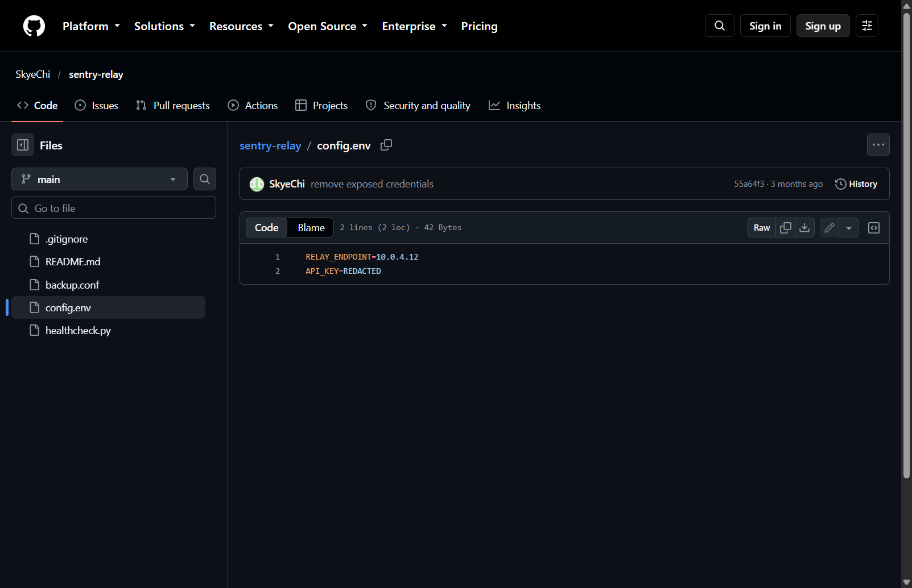
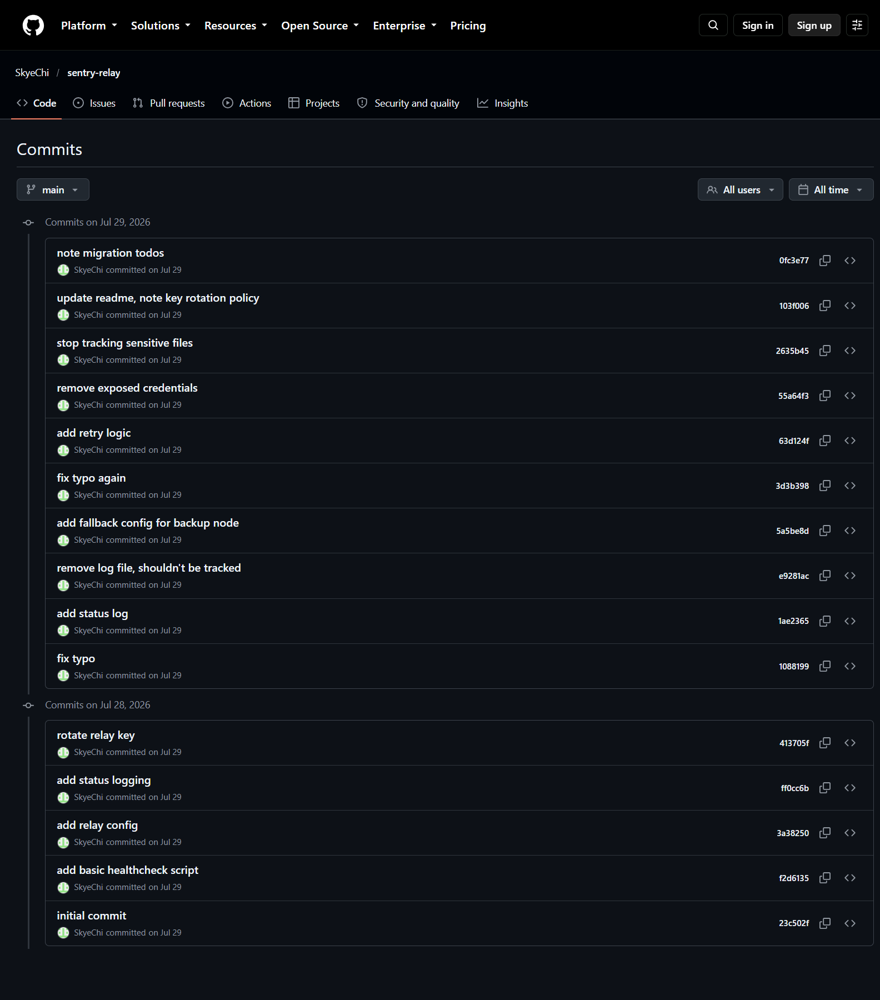
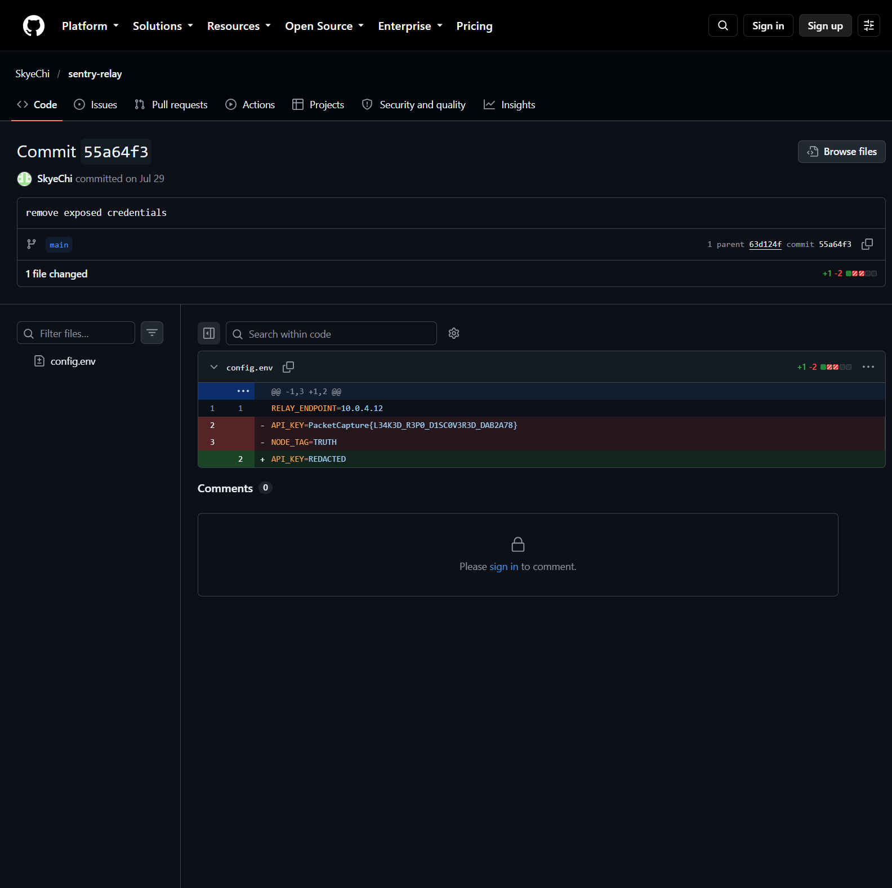

Flag: PacketCapture{L34K3D_R3P0_D1SC0V3R3D_DAB2A78}
Category: OSINT
Tools used: GitHub CLI (gh api), grep

Steps:
1. Start point: the repository github.com/SkyeChi/sentry-relay.
   - What I found: the current config.env shows API_KEY=REDACTED.
   - Thinking: a file that has clearly been scrubbed tells you a secret used to be there. Git keeps every version of
     every file, so the question becomes "which older version still has it?"

     

2. Pivot: the commit history.
   - What I did: listed all 15 commits and read the messages.
   - Result: messages such as "rotate relay key", "remove exposed credentials" and "stop tracking sensitive files".
   - Thinking: these messages are the developer admitting a leak. They point straight at the commits worth diffing,
     which saves reading the whole repo.

     

3. Pivot: the diffs.
   - What I did: pulled every commit's patch with gh api and grepped for "PacketCapture{" and "KEY".
   - Result: the real key was added in commit 413705f ("rotate relay key") and removed in 55a64f3
     ("remove exposed credentials"); the removal diff still shows it in red. Two other flag-shaped values also appear
     in the history:
     - API_KEY=PacketCapture{DECOY_ENDPOINT}
     - BACKUP_KEY=PacketCapture{RELAY_BACKUP_KEY}
     - API_KEY=PacketCapture{L34K3D_R3P0_D1SC0V3R3D_DAB2A78}
   - Thinking: the two decoys are named after config fields rather than telling a story, which is a common way
     authors plant wrong answers. The real one reads as a sentence ("leaked repo discovered") and ends with a short
     hash-like suffix, which is how real flags in this CTF look.

     

4. Verification: submitted the third value and the site accepted it.

Key insight: Deleting a secret in a new commit doesn't remove it from git history. Always read the diffs, not just
the latest files, and expect decoys when several flag-shaped strings appear.
