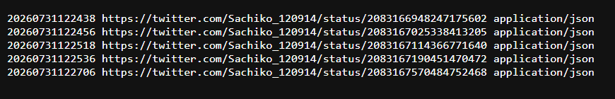
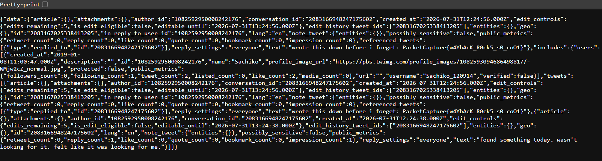
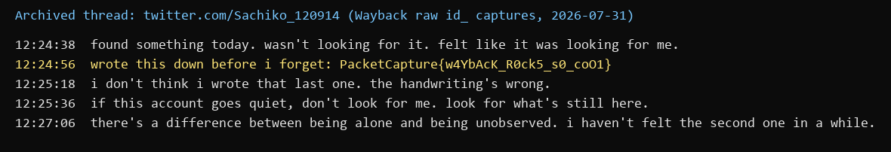

Flag: PacketCapture{w4YbAcK_R0ck5_s0_coO1}
Category: OSINT
Tools used: Wayback Machine CDX API, Wayback raw snapshot viewer (id_ mode), curl, Python

Steps:
1. Start point: the profile x.com/Sachiko_120914.
   - What I found: the live page can't be read directly, and the brief says it is effectively empty ("she stopped
     posting... her page still exists, technically").
   - Thinking: the brief also says she is "remembered differently, by different tools". Content that is gone from the
     live site but "remembered" by tools points to web archives, so the Wayback Machine is the next stop.

2. Pivot: the Wayback Machine CDX index for x.com.
   - What I did: queried the CDX API for x.com/Sachiko_120914.
   - Result: no captures.
   - Thinking: an empty result under x.com doesn't mean nothing was archived. X only renamed its domain in 2023, and
     many archiving tools still file captures under twitter.com, so the same account has to be checked on the old domain.

3. Pivot: the same handle on twitter.com, with matchType=prefix.
   - What I did: queried web.archive.org/cdx/search/cdx?url=twitter.com/Sachiko_120914&matchType=prefix
   - Result: 5 captured status URLs, all saved on 2026-07-31 as application/json (individual tweets, not the profile).
   - Thinking: prefix matching is the key detail. A plain lookup only checks the profile URL itself; prefix lists every
     archived URL underneath it, which is where the individual tweets live.

     

4. Pivot: the raw captures.
   - What I did: opened each capture with "id_" after the timestamp, e.g.
     web.archive.org/web/20260731122456id_/https://twitter.com/Sachiko_120914/status/2083167025338413205
   - Result: the original JSON, without the Wayback toolbar or rewriting. The "text" field of the 12:24:56 reply holds
     the flag.
   - Thinking: "id_" returns the bytes exactly as captured, which matters for JSON captures that the normal viewer
     wraps or fails to render.

     

5. Pivot: reading the thread as a whole.
   - Result: the five tweets in order (the flag is the second):

     

   - Thinking: the flag reads "Wayback rocks so cool", which confirms the intended path. The next tweet ("the
     handwriting's wrong") is flavour text rather than a second layer.
   - Care point: copy the flag exactly from the raw JSON. It has an underscore between "s0" and "coO1".

Key insight: Deleted or hidden posts can still exist in web archives. For X/Twitter, search both x.com and
twitter.com, use the CDX API with matchType=prefix to list every captured URL under a profile (including individual
tweets), and add id_ to read the raw capture.
