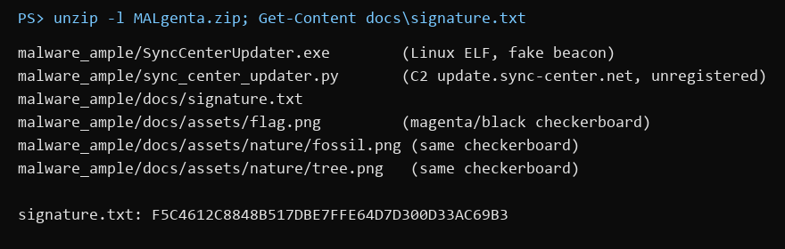
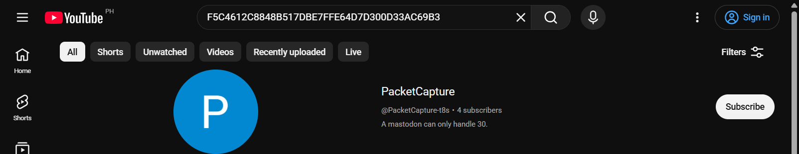
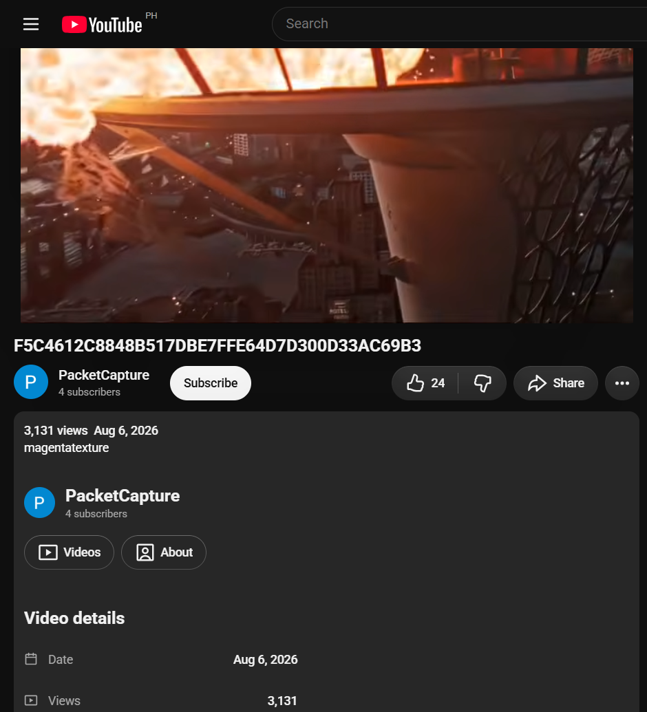
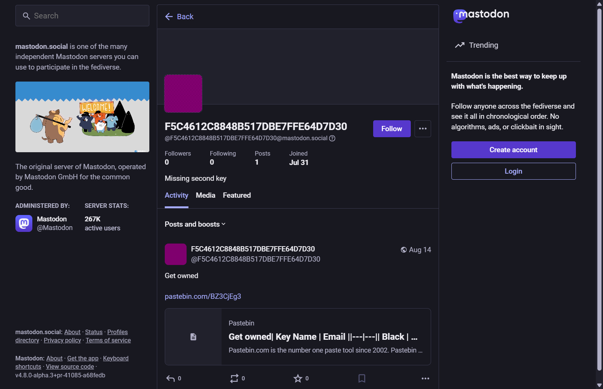
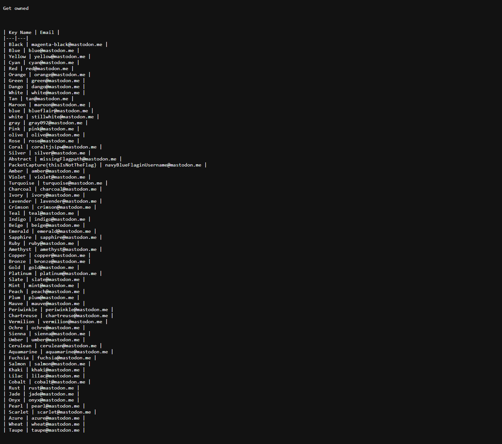
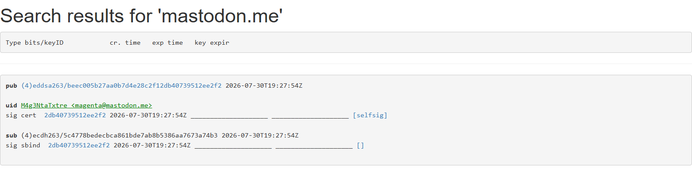
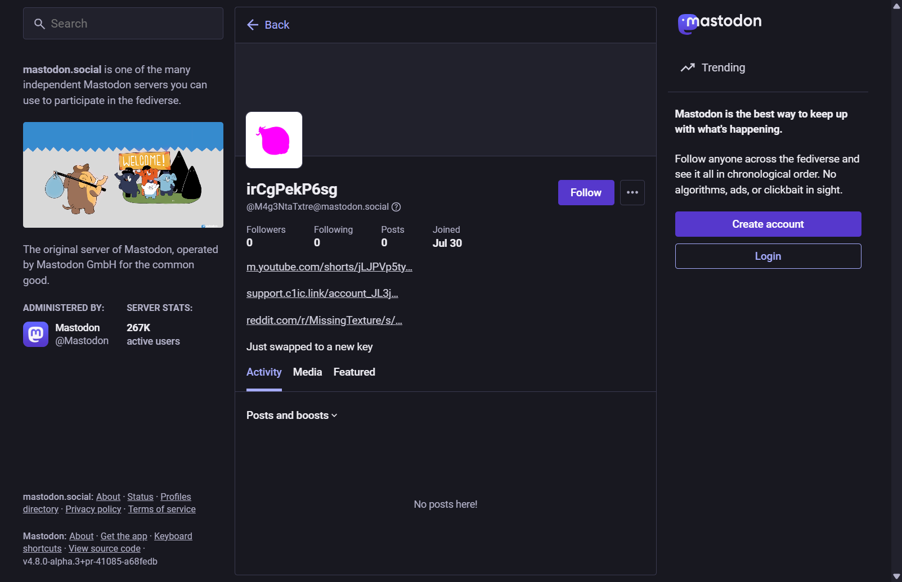
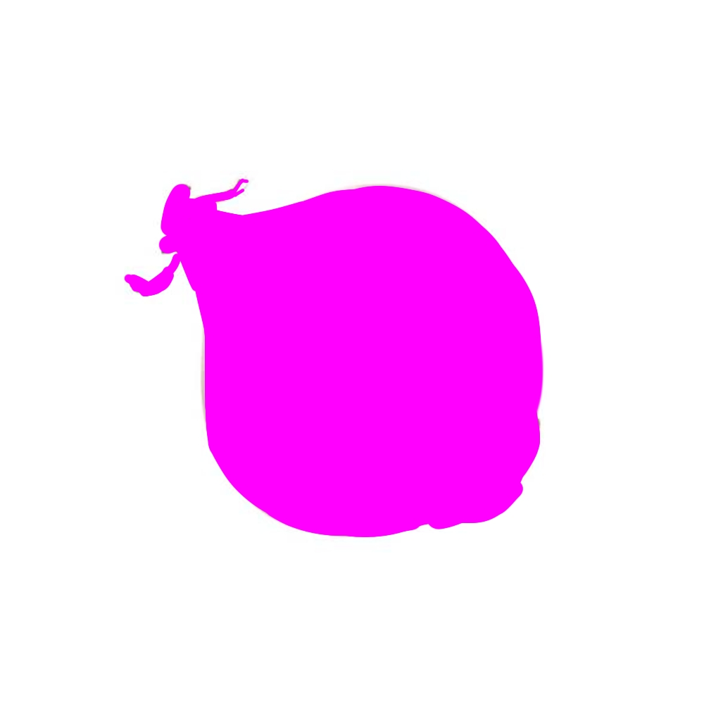
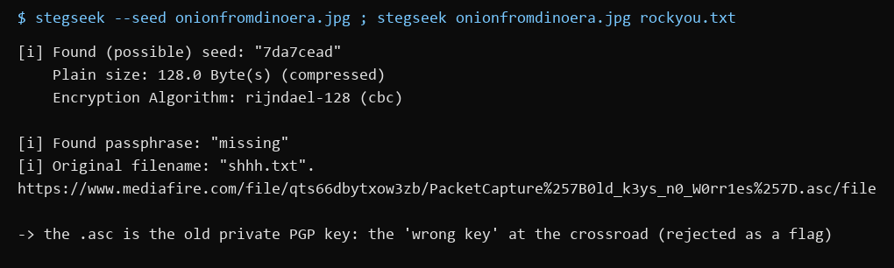
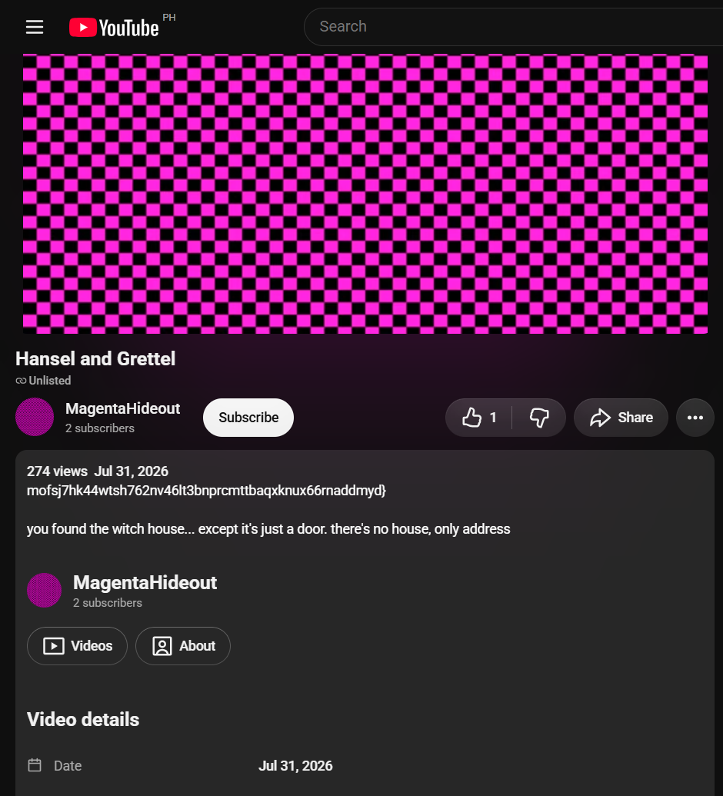

Flag: PacketCapture{magentatexturemofsj7hk44wtsh762nv46lt3bnprcmttbaqxknux66rnaddmyd}
Category: OSINT
Tools used: curl, yt-dlp, Mastodon public API, Ubuntu PGP keyserver, gpg, steghide/stegseek (Docker), Python

Steps:
1. Start point: MALgenta.zip from MediaFire.
   - What I found: a fake "malware sample" (a harmless Linux binary and a matching .py beacon), three identical
     magenta/black checkerboard PNGs, and docs/signature.txt = F5C4612C8848B517DBE7FFE64D7D300D33AC69B3.
   - Thinking: the binary and C2 domain went nowhere (the domain was never registered), so the only unique, searchable
     artifact was the 40-character "signature". The brief says to "keep abusing the breadcrumb at every place you've
     been", so the hash itself is the breadcrumb to search everywhere.

     

2. Pivot: the hash on YouTube.
   - What I did: searched the full hash on YouTube.
   - Result: a channel named "PacketCapture" ("A mastodon can only handle 30.") with one Short titled with the hash.
     The clip is from Final Destination and the description is "magentatexture".
   - Thinking: "magentatexture" names the checkerboard (the classic missing-texture image), and the channel line says
     Mastodon usernames max out at 30 characters. So the next stop is the first 30 characters of the hash on Mastodon.
     The Final Destination clip later turned out to mark this Short as the "final destination" in Intel 3.

     

     

3. Pivot: the first 30 characters on Mastodon.
   - What I did: looked up @F5C4612C8848B517DBE7FFE64D7D30 on mastodon.social.
   - Result: avatar = the magenta/black checkerboard, bio = "Missing second key", one post "Get owned" linking a
     Pastebin paste.
   - Thinking: "second key" suggested something key-shaped was still to be found.

     

4. Pivot: the Pastebin paste (the first crossroad).
   - What I found: a table "Key Name | Email" of 65 colours, each with an address @mastodon.me, plus a decoy row
     PacketCapture{thisIsNotTheFlag} and a few odd names (blueflair, stillwhite, coraltjsipw...).
   - Dead ends: I spent a long time treating the odd names as usernames on other sites; they led only to real,
     unrelated people (one is a Roblox YouTuber), which the rules say not to pursue.
   - Thinking that worked: "Key Name" + email is exactly how a PGP keyring lists keys, the Mastodon bio says
     "Missing second key", and Magenta is the one obvious colour missing from the list. So the missing key is probably
     a real PGP key published under that email domain.

     

5. Pivot: the PGP keyserver.
   - What I did: searched keyserver.ubuntu.com for "mastodon.me".
   - Result: exactly one key, "M4g3NtaTxtre <magenta@mastodon.me>", created 2026-07-30 (the same week as the zip).
   - Thinking: M4g3NtaTxtre is leetspeak for "MagentaTexture", so this is the second sibling. Following the brief again,
     the new name is the next breadcrumb to try on every site already visited.

     

6. Pivot: M4g3NtaTxtre on Mastodon (the real crossroad from Intel 1).
   - Result: an account made the same day, with display name "irCgPekP6sg", bio "Just swapped to a new key", and
     three links (a public video about the error texture, a r/MissingTexture link, and a CreepyLink short URL).
   - Thinking: Intel 1 says the crossroad has one path to the sibling and one to a "wrong key". The display name is
     11 characters in YouTube's video-ID alphabet, so it's a path to try. The short URL is the other path.

     

7. Path A, the wrong key.
   - What I did: read the CreepyLink redirect without opening it. It pointed to a MediaFire image, onionfromdinoera.jpg
     (a magenta onion). stegseek confirmed hidden steghide data, and a dictionary attack recovered the passphrase
     "missing". The payload linked to a file named PacketCapture{0ld_k3ys_n0_W0rr1es}.asc.
   - Result: that file is the private half of the M4g3NtaTxtre PGP key, and its name was rejected as a flag.
   - Thinking: "old keys" plus "Just swapped to a new key" marks this branch as the decoy "wrong key".

     

     

8. Path B, the sibling.
   - What I did: opened youtube.com/watch?v=irCgPekP6sg.
   - Result: an unlisted video, "Hansel and Grettel", by @MagentaHideout. It is a magenta/black checkerboard (the
     "world of two colors" from Intel 3). Its description is
     mofsj7hk44wtsh762nv46lt3bnprcmttbaqxknux66rnaddmyd} and "you found the witch house... there's no house, only address".
   - Thinking: the closing brace means this is the back half of the flag. The front half has to come from the other
     sibling.

     

9. Reuniting the siblings.
   - Thinking: Intel 3 says the other half "is found at the final destination", which is the Final Destination Short
     from step 2 (screenshot 03). Intel 2 and 4 say the "house" is back on the original breadcrumb trail. The only
     text that Short carries besides the hash is its description, "magentatexture".
   - Result: PacketCapture{ + magentatexture + mofsj7hk44wtsh762nv46lt3bnprcmttbaqxknux66rnaddmyd} was accepted.
   - Note: I had tried "magentatexture" on its own early on (rejected) and the tail on its own (rejected). Neither half
     works alone, which is the whole point of "reunite the two siblings".

Key insight: Each pivot reuses the latest clue on a site already visited (hash > YouTube > Mastodon > paste > PGP
keyserver > Mastodon > YouTube). The decoys (thisIsNotTheFlag, 0ld_k3ys) are labelled as wrong keys by the story
itself, and the flag is split, so both halves must be joined before submitting.
