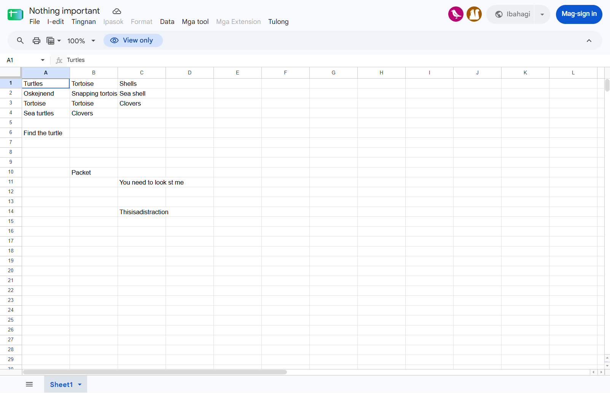
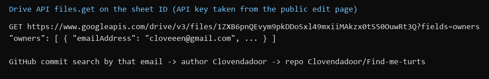
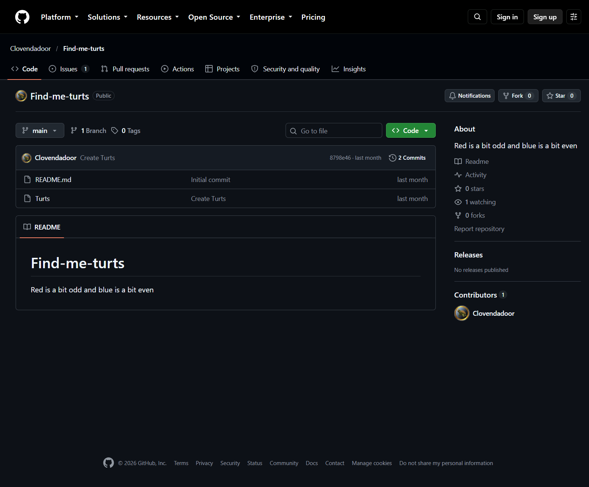
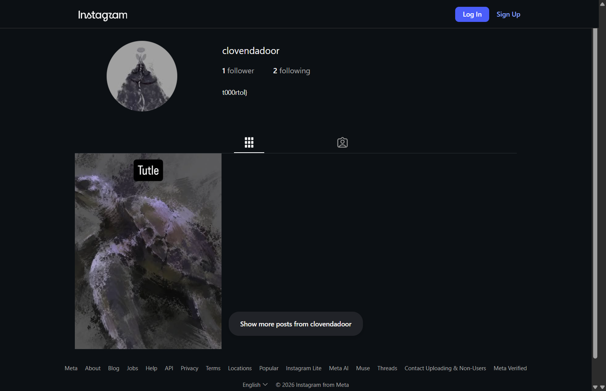
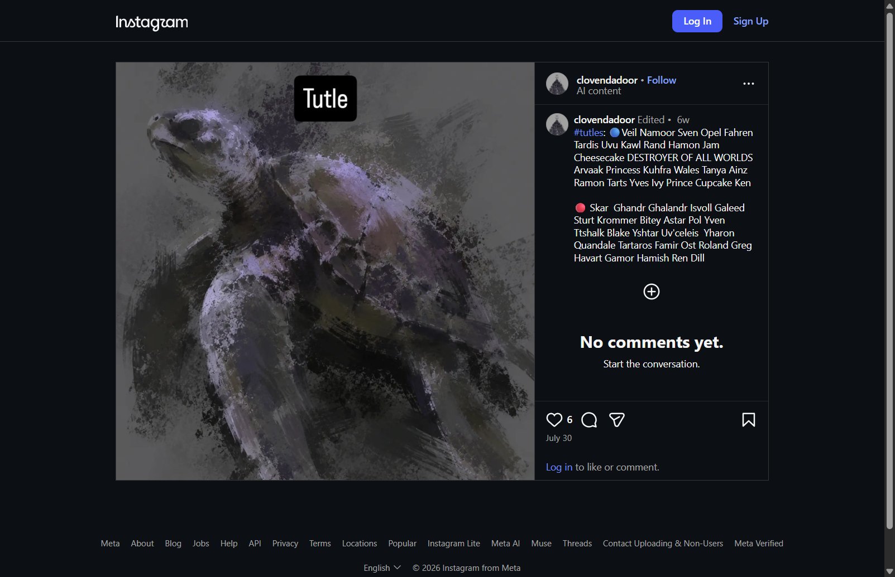
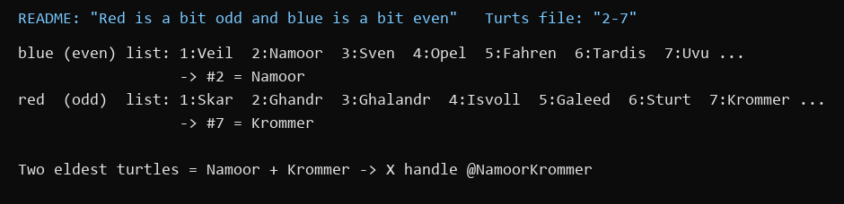
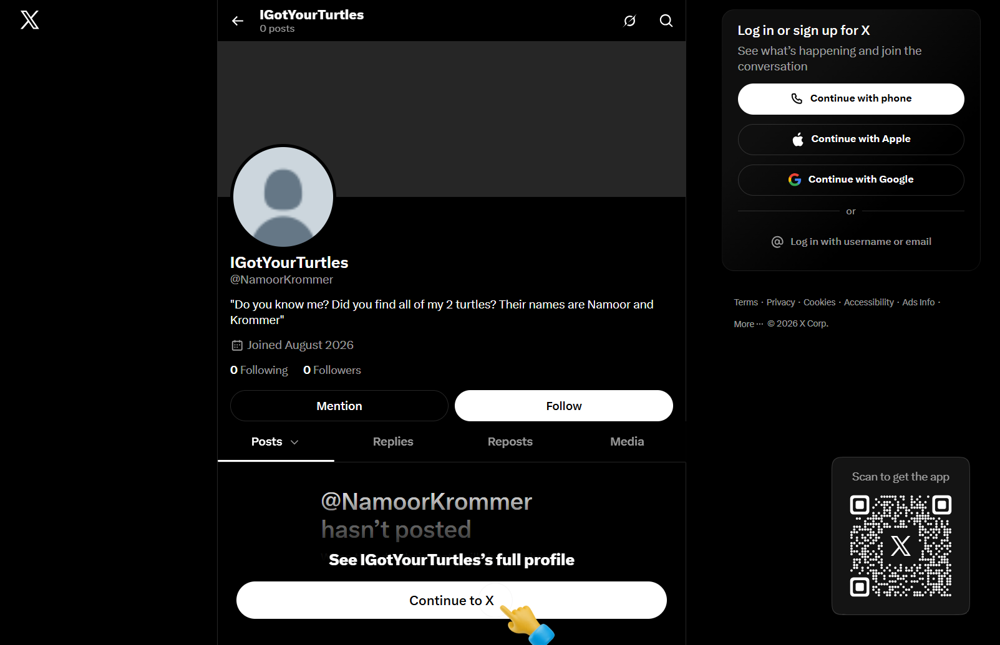
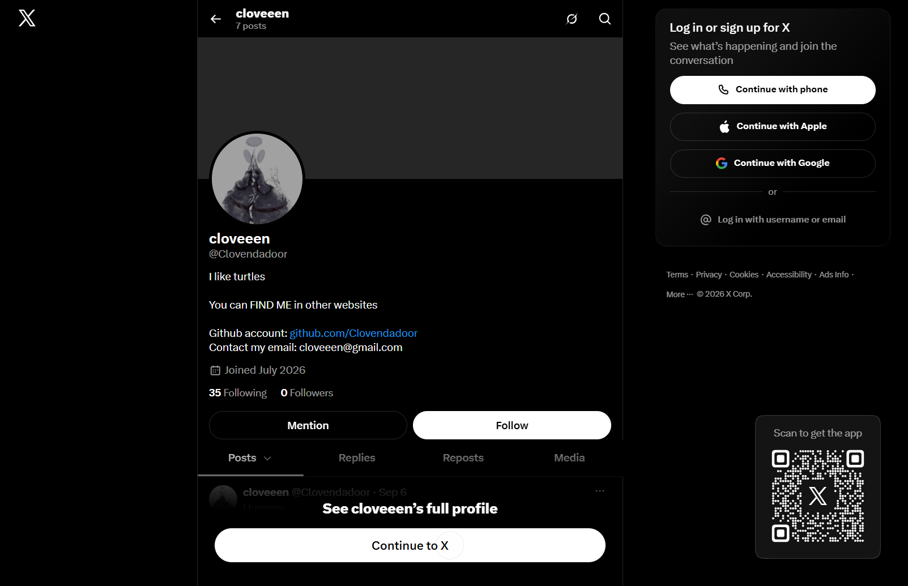

Flag: PacketCapture{p3rf3ctly_P13c3D}
Category: OSINT
Tools used: Google Drive API (file owner lookup), GitHub commit search, username OSINT, Instagram, X/Twitter, email

Steps:
1. Start point: the shared Google Sheet ("Nothing important").
   - What I found: a few turtle-themed cells (Turtles, Tortoise, Shells, "Find the turtle", "You need to look st me",
     "Thisisadistraction").
   - Thinking: the brief says "think outside of the cell", so the cell contents are mostly distraction. What a
     spreadsheet carries outside its cells is its file metadata, above all who owns it.

     

2. Pivot: the sheet's owner.
   - What I did: queried the Drive API for the file's owners (the public edit page exposes an API key), then searched
     GitHub commits by the owner's email.
   - Result: owner = cloveeen@gmail.com, which leads to the GitHub user Clovendadoor.
   - Thinking: "see the identities linked to it without being named" is exactly this: an email that's never written in
     the sheet but is attached to it.

     

3. Pivot: the GitHub repo Clovendadoor/Find-me-turts.
   - Result: README "Red is a bit odd and blue is a bit even", and a file named Turts containing "2-7".
   - Thinking: both are instructions for something not on GitHub. They read like a selection rule (a colour, odd or
     even, positions 2 and 7), so the next step is to find a list with red and blue parts.

     

4. Pivot: the username Clovendadoor on other sites (Instagram).
   - Result: instagram.com/clovendadoor, bio "t000rtol}", and one post whose caption lists turtle names in two groups,
     one marked with a blue circle and one with a red circle.
   - Thinking: this is the list the repo's rule applies to. Blue is "even" and red is "odd", and "2-7" gives the
     positions: blue #2 = Namoor, red #7 = Krommer.
   - Dead ends: the bio "t000rtol}" looks like a flag ending but is not part of the final flag.

     

     

     

5. Pivot: the turtle names as an X handle.
   - What I did: followed the released hint ("some random guy on X decided to use the names of my two turtles as their
     handle") and looked up @NamoorKrommer.
   - Result: account "IGotYourTurtles", bio: "Do you know me? Did you find all of my 2 turtles? Their names are Namoor
     and Krommer".
   - Thinking: the second hint says "look at my bio and his", so this bio has to be paired with the owner's bio.

     

6. Pivot: the owner's X account and contact email.
   - What I found: @Clovendadoor ("cloveeen") has the bio "You can FIND ME in other websites... Contact my email:
     cloveeen@gmail.com" and a tweet: "Someone took all of my turtles and had the nerve to use the name of my two
     eldest turtles as their @ in this site".
   - Thinking: the third hint says "no one would tell me where my turtles are... please contact me". Putting the two
     bios together, the last step is to contact the owner's email with the answer to the question in @NamoorKrommer's
     bio (the two turtles, Namoor and Krommer). Doing that returned the flag.

     

Key insight: Every identity here is linked, not named. The sheet's metadata gives the email, the email gives GitHub,
the username gives Instagram and X, and the rules on one platform (odd/even, 2-7) decode the list on another. The
final step isn't a search at all: the hints and bios tell you to contact the owner.
