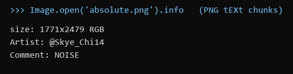
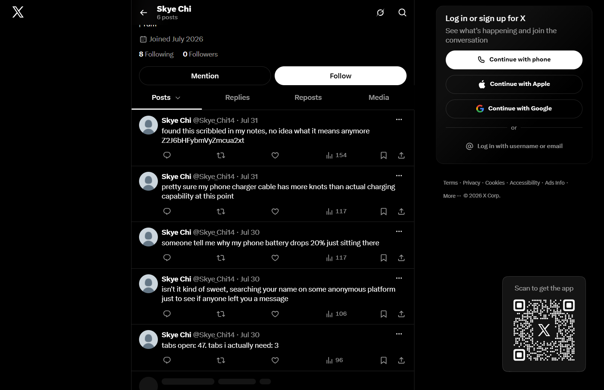
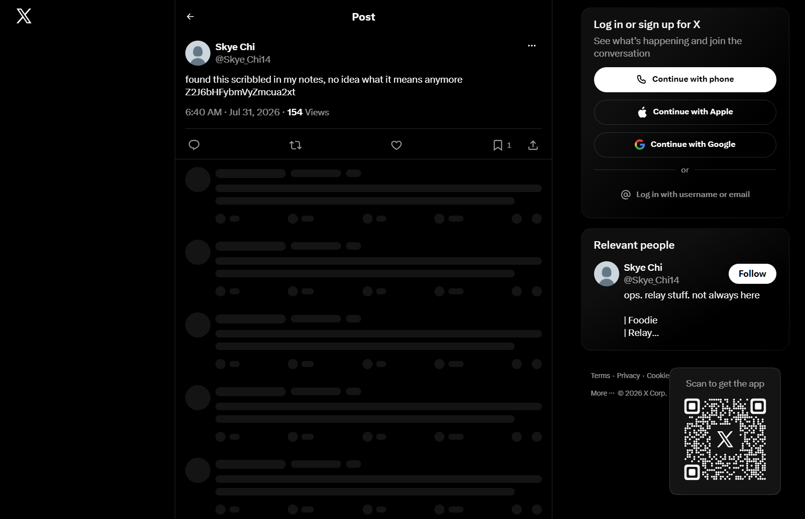
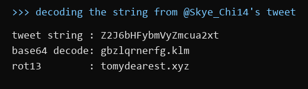
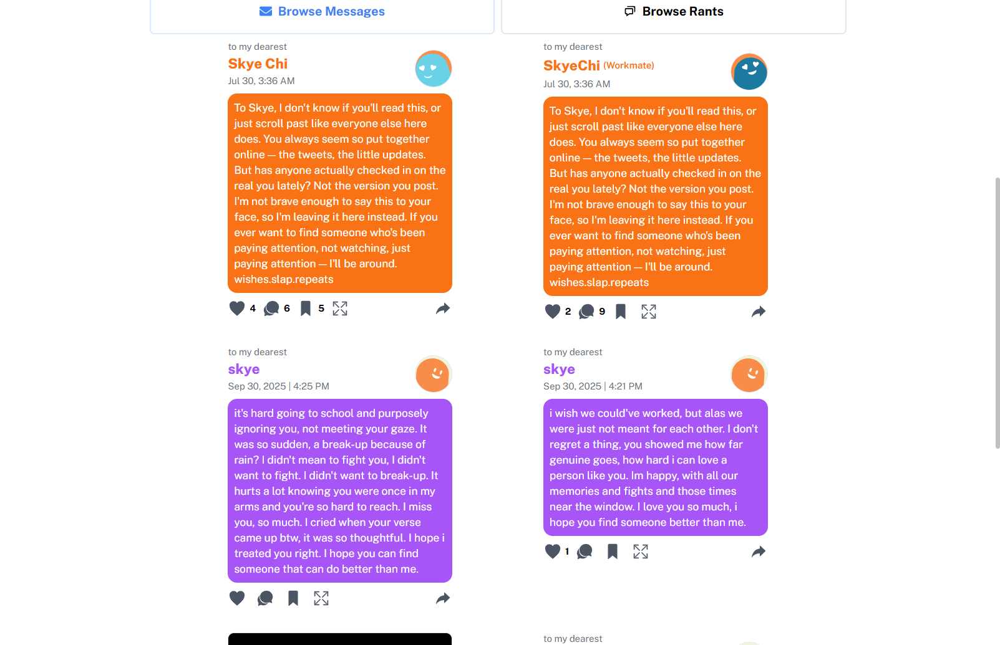
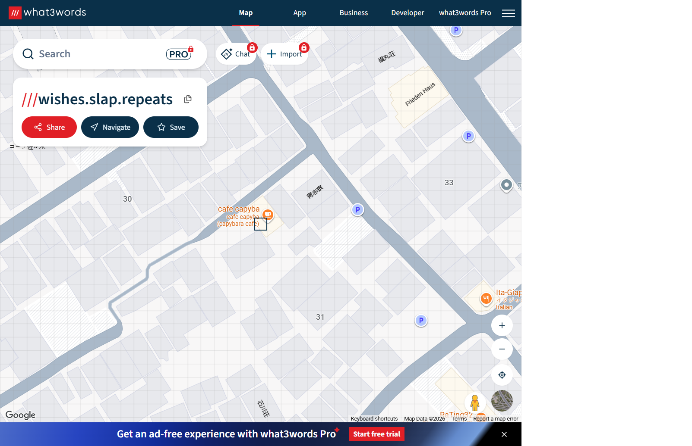
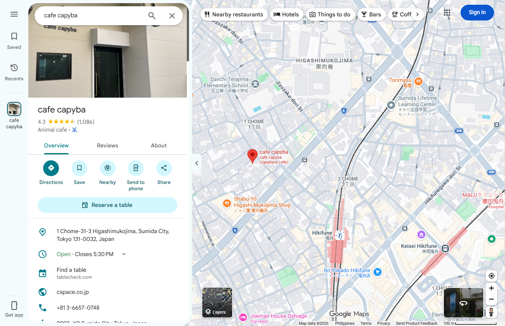

Flag: PacketCapture{+81366570748}
Category: OSINT (Medium)
Tools used: PNG metadata inspection (Python PIL / exiftool), Python (Base64 + ROT13), X/Twitter, tomydearest.xyz, what3words, Google Maps

Steps:
1. Start point: absolute.png (a black-and-white portrait).
   - What I found: the PNG text chunks carry Artist = @Skye_Chi14 and Comment = NOISE.
   - Thinking: the brief says the image "was shared without anyone checking what came with it" and to "follow what
     the picture doesn't say". That points at metadata, not the visible content. The face in the photo is a decoy:
     identifying the person leads nowhere and isn't part of the puzzle.

     

2. Pivot: the handle @Skye_Chi14 on X.
   - What I found: a small account (joined July 2026, bio "ops. relay stuff... Foodie") with a few everyday posts.
     Two stand out:
     - "found this scribbled in my notes, no idea what it means anymore Z2J6bHFybmVyZmcua2xt"
     - "isn't it kind of sweet, searching your name on some anonymous platform just to see if anyone left you a message"
   - Thinking: the random-looking string is the only non-natural text on the account, so it's the next clue. The second
     post explains how to use what it decodes to: search her name on an anonymous message site.

     

     

3. Pivot: decoding the string.
   - What I did: Base64 decode, then ROT13.
   - Result: Z2J6bHFybmVyZmcua2xt -> gbzlqrnerfg.klm -> tomydearest.xyz
   - Thinking: the Base64 output had a dot and a three-letter "extension", so it looked like a domain with its letters
     shifted. ROT13 is the most common shift in CTFs and turned it into a real site.

     

4. Pivot: tomydearest.xyz, an anonymous "message to someone" site.
   - What I did: searched messages by the name "Skye", as the tweet suggested.
   - Result: an anonymous message "To Skye..." ("If you ever want to find someone who's been paying attention...
     I'll be around.") that ends with three dot-separated words: wishes.slap.repeats
   - Thinking: three lowercase words joined by dots is the what3words address format, a way to name a 3 m square
     anywhere in the world. This message is the "way to reach them" the brief mentions.

     

5. Pivot: the what3words address.
   - What I did: opened what3words.com/wishes.slap.repeats.
   - Result: the square sits on "cafe capyba (capybara cafe)" in Higashimukojima, Sumida City, Tokyo.
   - Thinking: the brief says "reservations here aren't taken online - someone still has to actually call", so the
     answer is the venue's phone number, not its name or address.

     

6. Pivot: the venue on Google Maps.
   - What I did: looked up cafe capyba on Google Maps.
   - Result: 1-31-3 Higashimukojima, Sumida City, Tokyo; phone +81 3-6657-0748.
   - Formatting: the number without spaces or dashes, in international format: PacketCapture{+81366570748}.

     

Key insight: Each clue was in an overlooked place (image metadata, an encoded tweet, a what3words address hidden in
an anonymous message), while the obvious leads (the face in the photo, the account's food posts) were decoys. The
account's own "throwaway" tweets explained how to use each clue.
