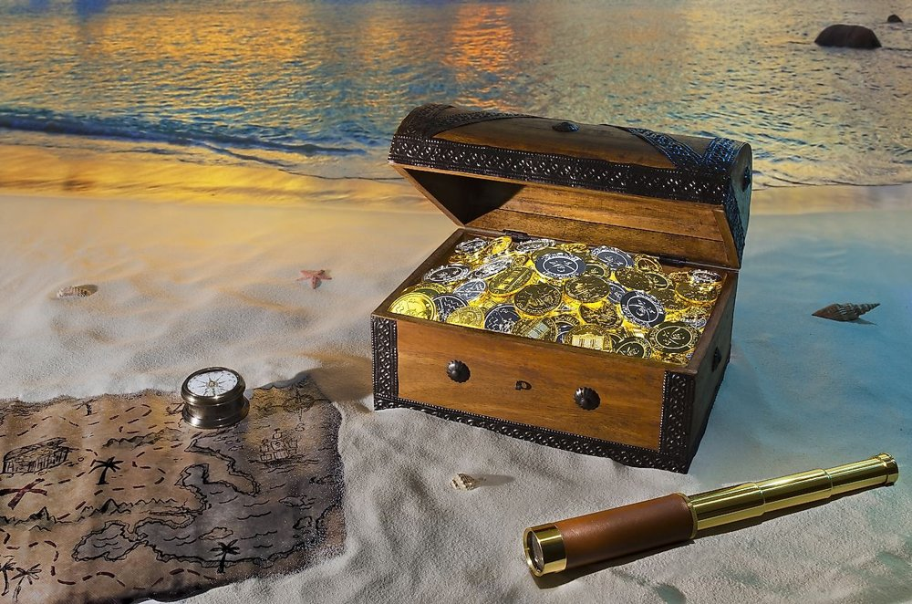
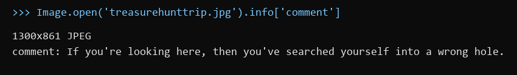
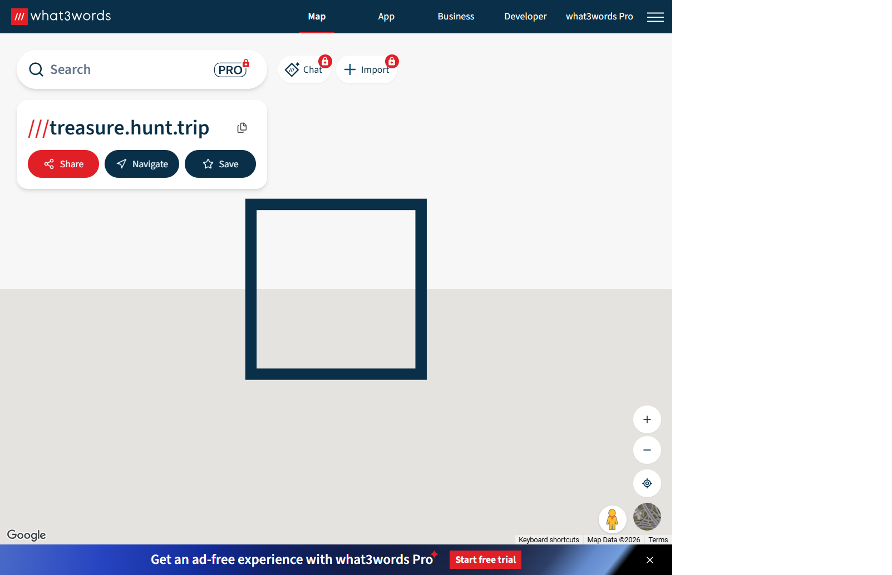
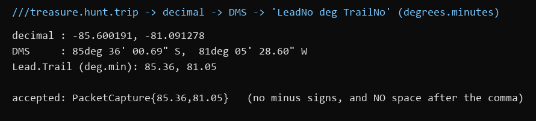

Flag: PacketCapture{85.36,81.05}
Category: OSINT
Tools used: Python (Pillow) for image metadata, what3words, DMS coordinate conversion

Steps:
1. Start point: treasurehunttrip.jpg from MediaFire.
   - What I found: a stock-style photo of a treasure map scene. Nothing in the picture itself names a place.

     

2. Pivot: the image's metadata.
   - Result: the JPEG comment says "If you're looking here, then you've searched yourself into a wrong hole."
   - Thinking: this is the author telling you the metadata/stego path is a decoy. I confirmed it by matching the photo
     to its stock original (pixel-identical) and running steghide, which found nothing. So the answer isn't hidden in
     the file; it has to come from the brief.

     

3. Pivot: re-reading the brief.
   - What I found: the challenge is tagged OSINT, it says "I don't know if 3 words would even suffice", and it asks for
     "Coordinate Type: DMS convert from LeadNo deg TrailNo".
   - Thinking: "3 words" + coordinates = what3words, which names every 3 m square with three words. The only three
     words the challenge gives are in the file name: treasure / hunt / trip.

4. Pivot: ///treasure.hunt.trip on what3words.
   - Result: a square at -85.600191, -81.091278, in Antarctica (the map shows nothing there, which is expected).

     

5. Pivot: converting to the requested format.
   - What I did: converted the decimal coordinates to DMS (degrees, minutes, seconds):
     85deg 36' 00.69" S, 81deg 05' 28.60" W.
   - Thinking: "LeadNo deg TrailNo" means the number before the degree sign (degrees) and the number right after it
     (minutes), written as degrees.minutes: 85.36 and 81.05.
   - Dead ends:
     - PacketCapture{-85.60, -81.09} (decimal degrees rounded) was rejected: the brief asks for DMS, not decimal.
     - The format shown in the brief, PacketCapture{00.00, 00.00}, has a space after the comma, but the accepted flag
       has no space and no minus signs.

     

Key insight: When the file says "wrong hole", go back to the brief. Here the coordinates came from the file name
(what3words), and the hard part was formatting: DMS degrees.minutes, no signs, no space.
