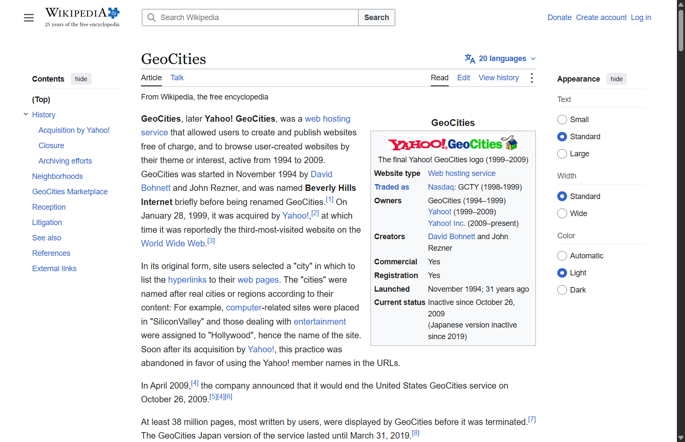

Flag: PacketCapture{GEOCITIES_26OCT2009}
Category: OSINT (internet history)
Tools used: Web search, Wikipedia, Internet Archive / Archive Team pages

Steps:
1. Start point: the brief.
   - What I found: "millions of pages, each one someone's first attempt at building something online", "blinking
     text, guestbooks, visitor counters", then "deleted. On purpose. All at once." The answer format is
     PacketCapture{NAME_DDMONYEAR}.
   - Thinking: every detail describes a free 1990s web-hosting service. Blinking text, guestbooks, hit counters and
     "Under Construction" GIFs (the challenge title) are the signature look of personal homepages from that era. The
     phrase "on purpose, all at once" rules out services that faded away slowly; it points to a company deliberately
     shutting the whole service down on a single date.

2. Pivot: which hosting service fits "millions of pages" and a deliberate mass deletion.
   - What I did: compared the big free hosts of the era (GeoCities, Angelfire, Tripod).
   - Result: GeoCities is the one that matches. Angelfire and Tripod still exist. GeoCities hosted tens of millions of
     pages, and Yahoo, which bought it in 1999, closed it and deleted every user page at once.
   - Thinking: the challenge title, "Under Construction", is itself the most famous GeoCities-era GIF, which confirms
     the name.

3. Pivot: the exact date it disappeared "for good".
   - What I did: checked the shutdown history (Wikipedia, and the Archive Team rescue project that mirrored the site
     before deletion).
   - Result: Yahoo announced the closure in April 2009, stopped new sign-ups, and deleted GeoCities on
     26 October 2009.
   - Screenshot (the infobox says "Inactive since October 26, 2009", and the article notes the Japan version
     lasted until 2019):

     
   - Dead ends / care point: GeoCities Japan was a separate service that ran until 31 March 2019. The brief describes
     the main service whose millions of pages vanished all at once, so the 2009 US shutdown date is the one asked for.
     The announcement date (April 2009) is also not the deletion date.

4. Formatting the flag.
   - Thinking: the template is NAME_DDMONYEAR, so the name is uppercase with no spaces, the day is two digits, the
     month is a three-letter abbreviation, and the year has four digits: GEOCITIES_26OCT2009.
   - Result: PacketCapture{GEOCITIES_26OCT2009} was accepted.

Key insight: The description itself is the search query. Turn era-specific details (blinking text, guestbooks,
visitor counters, "Under Construction") into a candidate, then pin the exact date with a primary source, watching
for near-miss dates (the announcement date, or a regional spin-off that closed later).
