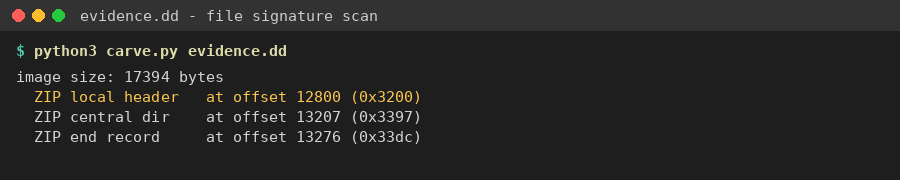
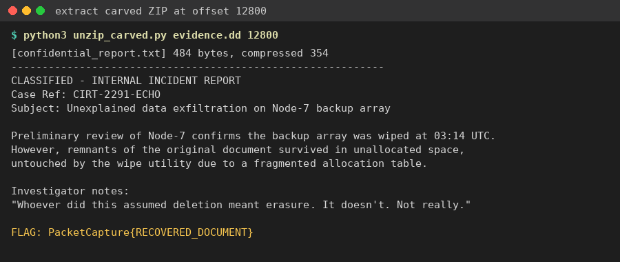

Flag: PacketCapture{RECOVERED_DOCUMENT}
Category: Digital Forensics (Disk / File Carving)
Tools used: strings, Python (zipfile)

Steps:
1. Start point: evidence.dd (17 KB disk image).
   - What I found: almost all high-entropy noise with no filesystem structure, which is what a wiped or damaged
     volume looks like.
   - Thinking: when the filesystem is gone, ignore it and carve by file signature.

2. Pivot: carving for signatures.
   - What I did: searched the raw bytes for common magic numbers.
   - Result: a ZIP local file header (PK\x03\x04) at offset 12800 (0x3200). Its central directory and end record
     (PK\x01\x02 / PK\x05\x06) are intact right after, so the archive is complete.
   - It holds one file: confidential_report.txt (484 bytes, deflate).

     

3. Extraction.
   - What I did: opened the ZIP from that offset with Python's zipfile and read the file.
   - Result: "CLASSIFIED - INTERNAL INCIDENT REPORT, Case Ref: CIRT-2291-ECHO". The report says the Node-7 backup
     array was wiped at 03:14 UTC, but remnants "survived in unallocated space". The last line is
     FLAG: PacketCapture{RECOVERED_DOCUMENT}

     

Key insight: deleting or wiping the file table doesn't erase the data. Signature-based carving (PK, %PDF, JPEG FFD8,
etc.) finds intact files in unallocated space without any filesystem metadata.
