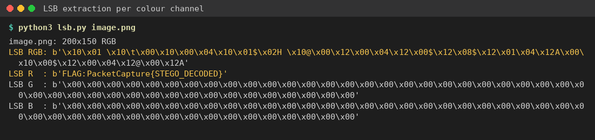

Flag: PacketCapture{STEGO_DECODED}
Category: Steganography
Tools used: Python (Pillow)

Steps:
1. Start point: a 200x150 PNG of purple/green diagonal stripes.
   - What I found: no metadata, no text chunks and no data appended after IEND. The image is a plain smooth
     gradient.
   - Thinking: a plain gradient image with nothing in the file structure usually means LSB (least significant bit)
     steganography. Changing the last bit of a colour value is invisible to the eye.

     

2. Pivot: LSB extraction per channel.
   - What I did: read the lowest bit of each pixel, row by row, and packed every 8 bits into a byte. I tried R, G and
     B separately and RGB interleaved.
   - Result: G and B gave only runs of 0x00/0xFF (no data), and RGB interleaved was noise. The red channel alone
     gave readable ASCII, terminated by a null byte:
     FLAG:PacketCapture{STEGO_DECODED}

     

Key insight: test each colour channel's LSB on its own as well as interleaved. Here the message was only in red, so the
common "RGB interleaved" extraction gives garbage.
