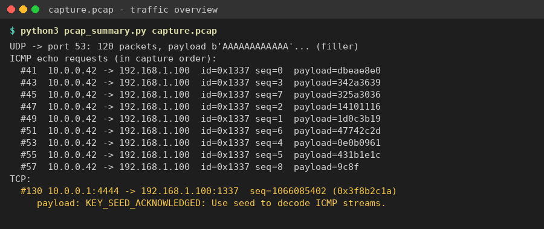
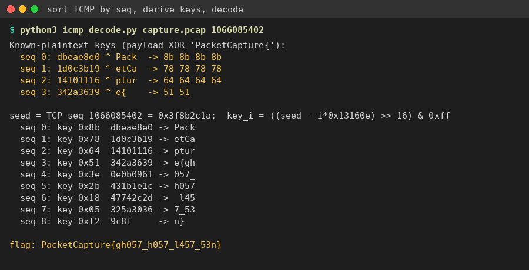

Flag: PacketCapture{gh057_h057_l457_53n}
Category: Network Forensics
Tools used: Python (dpkt)

Steps:
1. Start point: capture.pcap.
   - What I found: about 120 UDP packets to port 53, each with a payload of 28 'A' characters, from rotating
     192.168.1.x hosts; 9 ICMP Echo Requests from 10.0.0.42 to 192.168.1.100; and one TCP packet from port 4444 to
     1337 whose payload reads "KEY_SEED_ACKNOWLEDGED: Use seed to decode ICMP streams."
   - Thinking: the UDP traffic is filler: the second half repeats the first half's packets in reverse order. The ICMP packets carry
     the data, and the TCP packet is the hint.

     

2. Pivot: putting the ICMP stream back in order.
   - What I found: all 9 pings share ICMP ID 0x1337. Their payloads are 4 bytes each (2 in the last one), and they
     arrive out of order: the sequence numbers come in as 0, 3, 7, 2, 1, 6, 4, 5, 8.
   - What I did: sorted them by ICMP sequence number. Sorting by arrival time gives the wrong order.

3. Pivot: the seed.
   - What I found: the "KEY_SEED" packet's TCP sequence number is 1066085402 = 0x3F8B2C1A. Its second byte, 0x8B,
     XORed with the first payload (db ea e8 e0) gives "Pack".
   - Thinking: the key changes per packet. Known plaintext ("PacketCapture{") gives the first four keys:
     0x8B, 0x78, 0x64, 0x51. They fall by about 19.5 each time, which fits key_i = ((seed - i*D) >> 16) & 0xFF
     with a constant step D.
   - What I did: solved for the D range that fits the known keys. That gives the full key list
     0x8B 0x78 0x64 0x51 0x3E 0x2B 0x18 0x05 0xF2.

4. Decoding.
   - Result: XORing each sorted payload with its key gives PacketCapture{gh057_h057_l457_53n} (leetspeak for
     "ghost host last seen").

     

Key insight: ICMP payloads are a common covert channel. Reorder by sequence number, not timestamp. A known flag
prefix exposes the first keystream bytes, and from those you can work out the key schedule.
