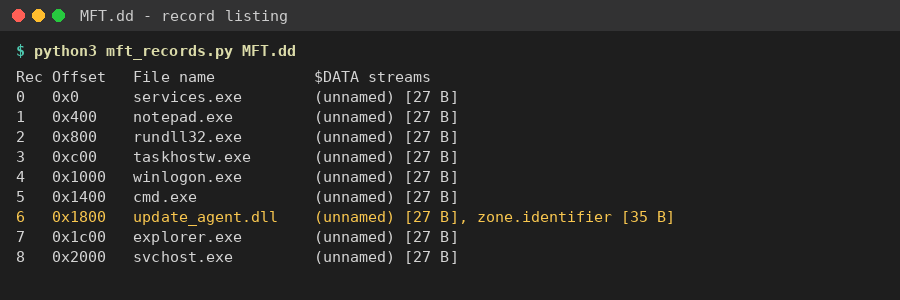
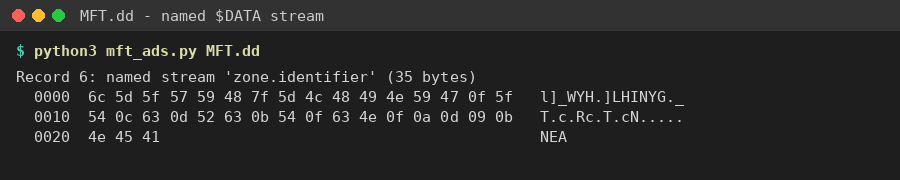
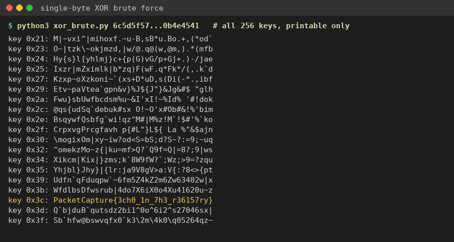

Flag: PacketCapture{3ch0_1n_7h3_r36157ry}
Category: Digital Forensics
Tools used: Python, strings

Steps:
1. Start point: MFT.dd (9 KB).
   - What I found: the file begins with "FILE" signatures, so it is a raw dump of NTFS Master File Table records. It
     holds 9 records: services.exe, notepad.exe, rundll32.exe, taskhostw.exe, winlogon.exe, cmd.exe,
     update_agent.dll, explorer.exe and svchost.exe.
   - Thinking: every record's $DATA is the same filler text ("System file content holder."), so the real content
     had to be in whichever record didn't match the rest.

     

2. Pivot: the odd record, update_agent.dll.
   - What I found: this is the only record with a second, named $DATA attribute. That is an Alternate Data Stream
     called "zone.identifier".
   - Thinking: ADS are a classic hiding spot because Explorer and `dir` don't show them. The real Windows stream is
     "Zone.Identifier" and holds plain text like "[ZoneTransfer] ZoneId=3". This one held 35 bytes of unreadable
     data, so it was disguised as something harmless.

     

3. Pivot: the hidden stream's bytes.
   - What I did: pulled the 35 bytes out with Python:
     6c 5d 5f 57 59 48 7f 5d 4c 48 49 4e 59 47 0f 5f 54 0c 63 0d 52 63 0b 54 0f 63 4e 0f 0a 0d 09 0b 4e 45 41
   - Thinking: no zlib, base64 or other file signature, but the values are clustered like text. That points to a
     single-byte XOR.

4. Decoding.
   - What I did: tried all 256 single-byte XOR keys and kept only the outputs that were fully printable.
   - Result: key 0x3C gives PacketCapture{3ch0_1n_7h3_r36157ry}. Every other printable output was gibberish.

     

Key insight: in a set of identical-looking records, look for the structural outlier, here the one file with an extra
named data stream. Short opaque blobs are often single-byte XOR, so brute-forcing all 256 keys is quick to try. The
flag text ("echo in the registry") matches the challenge story.
