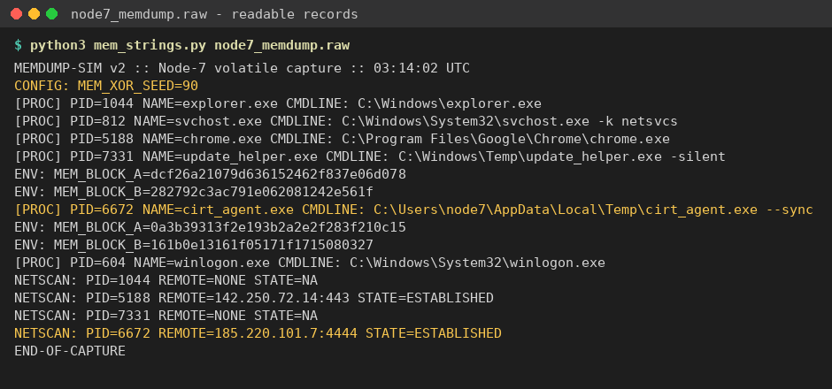
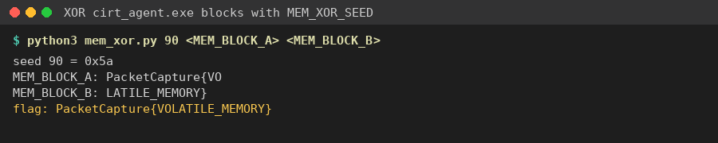

Flag: PacketCapture{VOLATILE_MEMORY}
Category: Digital Forensics (Memory)
Tools used: strings, Python

Steps:
1. Start point: node7_memdump.raw (2.7 KB, "MEMDUMP-SIM v2 :: Node-7 volatile capture :: 03:14:02 UTC").
   - What I found: random filler bytes with readable records in between: [PROC] entries (explorer.exe, svchost.exe,
     chrome.exe, update_helper.exe, cirt_agent.exe, winlogon.exe), ENV: lines, a NETSCAN section, and
     "CONFIG: MEM_XOR_SEED=90".

2. Pivot: the suspicious process.
   - What I found: NETSCAN shows PID 6672 cirt_agent.exe, running from %LOCALAPPDATA%\Temp with "--sync", holding an
     ESTABLISHED connection to 185.220.101.7:4444. Port 4444 is the classic reverse-shell / Metasploit port.
   - Its environment holds two blocks:
     MEM_BLOCK_A=0a3b39313f2e193b2a2e2f283f210c15
     MEM_BLOCK_B=161b0e13161f05171f1715080327
   - Dead end: update_helper.exe also has MEM_BLOCK_A/B values, but it has no network connection and its blocks don't
     decode with the seed, so it is a decoy.

     

3. Decoding.
   - Thinking: the config line hands over the key. MEM_XOR_SEED=90 is decimal 90 = 0x5A.
   - What I did: hex-decoded A + B and XORed every byte with 0x5A.
   - Result: block A = "PacketCapture{VO", block B = "LATILE_MEMORY}", joined = PacketCapture{VOLATILE_MEMORY}.

     

Key insight: tie the process list to network activity first. The process talking to a known-bad port is the one whose
data matters, and the key is sitting in the dump as a config value. Read "90" as decimal (0x5A), not hex.
