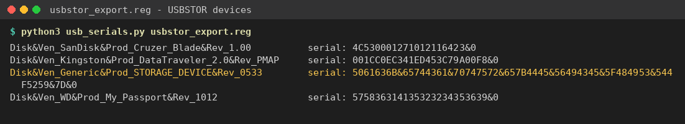
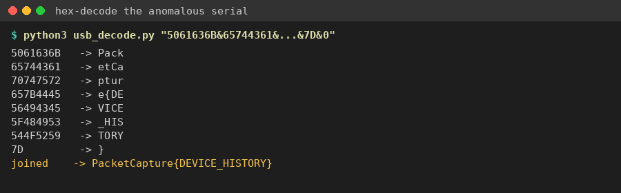

Flag: PacketCapture{DEVICE_HISTORY}
Category: Digital Forensics
Tools used: text editor, Python

Steps:
1. Start point: usbstor_export.reg.
   - What I found: an export of HKLM\SYSTEM\CurrentControlSet\Enum\USBSTOR with four USB storage devices: a SanDisk
     Cruzer Blade, a Kingston DataTraveler 2.0, a "Generic STORAGE_DEVICE" and a WD My Passport.
   - Thinking: the brief says "most entries look exactly like what you'd expect. One doesn't." Each USBSTOR subkey is
     "Disk&Ven_<vendor>&Prod_<product>&Rev_<rev>\<serial>&0", so I compared the serial numbers.

     

2. Pivot: the anomalous serial.
   - What I found: the Generic device's serial is
     5061636B&65744361&70747572&657B4445&56494345&5F484953&544F5259&7D&0
   - Thinking: real serials are one continuous string. This one is split into 8-character chunks by "&", and every
     chunk is valid hex. It starts with 50 61 63 6B, which is "Pack" in ASCII. A comment in the export also flags it:
     "serial number does not match any known vendor format".

3. Decoding.
   - What I did: removed the "&" separators and the trailing "&0" instance suffix, then hex-decoded the rest.
   - Result: Pack | etCa | ptur | e{DE | VICE | _HIS | TORY | } = PacketCapture{DEVICE_HISTORY}

     

Key insight: know what a normal artifact looks like (vendor, product, rev, serial) so the field that breaks the pattern
stands out. Hex that starts with 50 61 63 6B is "Pack", the start of the flag format.
