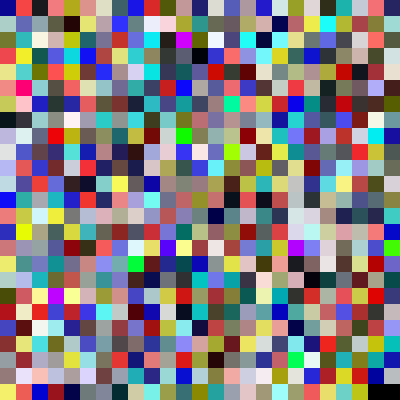
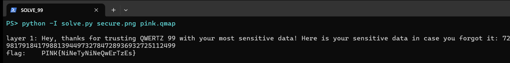

Flag: PINK{NiNeTyNiNeQwErTzEs}
Category: Crypto (QWERTZ-99 factoring)
Tools used: Python (Pillow), curl, trial-division factoring

Brief: The challenge was "99, 98, 4ll w31rd numb3rs. 4nd wh4t th3 h3ll 1s 4 .qmap f1l3??" It gave me secure.png (a 25x25 pixel-noise image), pink.qmap, and a free hint: 978b8b8f8cc5d0d098968b978a9dd19c9092d0aea8baadaba59a879ad0aea8baadaba5d2c6c6

Steps:
1. Start point: the hint hex
   - What I found: the first byte 0x97 XOR 0xFF is 0x68, which is "h". Flipping every bit (bitwise NOT) of every byte gives https://github.com/QWERTZexe/QWERTZ-99.
   - Thinking: a URL that starts with "http" has a recognisable first byte. 0x97 is exactly the inverse of "h", so the whole string is just NOT-ed.

2. Pivot: reading the QWERTZ-99 source
   - What I found, the .qmap format: [QMAP]{c:3}{s:1}(ord|code)... Every character (stored as its ord) maps to a 3-digit code. c:3 is the code width and s:1 means "98 mode" is supported.
   - What I found, encoding ("99"): concatenate each character's code, then append "99" as a terminator.
   - What I found, salting ("98"): drop the "99" and multiply the number by a password number P = int(concatenated password codes) * (product of every password code). Then append "-98".
   - What I found, the image: one symbol per pixel (0-9, or 11 for "-"). Each pixel holds two masked copies of the symbol, (num+m1, m1) and (m2, num+m2), and which RGBA channel goes first rotates with the pixel index (idx % 4). Decoding means taking the two differences and keeping the pixel only when both agree.
   - Thinking: this is security through obscurity. The masks are stored right next to the data they hide, so the image is an encoding, not encryption.

3. Pivot: decoding the image
   - What I did: reimplemented the pixel decoder in Python.
   - Result: a 620-digit number ending in "-98", so the message was salted with an unknown password: N = M * P.

     

4. Pivot: recovering the password without a wordlist
   - Dead end: I tried common words (pink, qwertz, secure, 99...) and every printable password up to 3 characters. Nothing divided N exactly.
   - Thinking: P is a product of the password's own codes, so its small prime factors have to appear in N. I factored N by trial division up to 100,000.
   - What I found: N = 2^6 * 3^14 * 5 * 73 * 137 * 163^4 * 691^2 * 4241 * (589-digit cofactor).
   - What I found: reading it against pink.qmap, "1" = 486 = 2*3^5, "3" = 978 = 2*3*163, "7" = 691. The password "13371337" has a code product of 2^6 * 3^14 * 163^4 * 691^2, which matches the exponents exactly. Its concatenated part 486978978691486978978691 = 486978978691 * (10^12 + 1), and 10^12 + 1 = 73 * 137 * 99990001. That explains the 73 and 137 as well.
   - Result: N mod P = 0 for "13371337", and N / P decodes with no unknown codes: "Hey, thanks for trusting QWERTZ 99 with your most sensitive data! Here is your sensitive data in case you forgot it: 72756517940796217918417988128949817918417988139449732784728936932725112499"

5. Pivot: the second layer
   - What I did: the trailing digit string ends in "99", so it is another QWERTZ-99 string. I decoded it with the same pink.qmap.
   - Thinking: the message said "your sensitive data", so the digits after the colon had to be the real payload, still encoded.
   - Result: PINK{NiNeTyNiNeQwErTzEs}. My solve.py run printed both layers and the flag.

     

Key insight: QWERTZ-98 "encryption" is multiplication by a number derived from the password, and multiplication leaks structure. The password's factors survive inside the ciphertext, so factoring the ciphertext's small primes reveals the password with no brute force. Real ciphers mix the key and data so that nothing about the key can be read back out of the output. Obscure formats and stacked encodings add effort, not security.

Reproduce: run python solve.py secure.png pink.qmap. It prints both layers and asserts the flag.

Note: pink.qmap is missing exactly one printable character, "_" (ord 95). That made me suspect underscores in the flag at first, so I relaxed my "decodes cleanly" check to tolerate one unknown code. In the end the flag has none.
