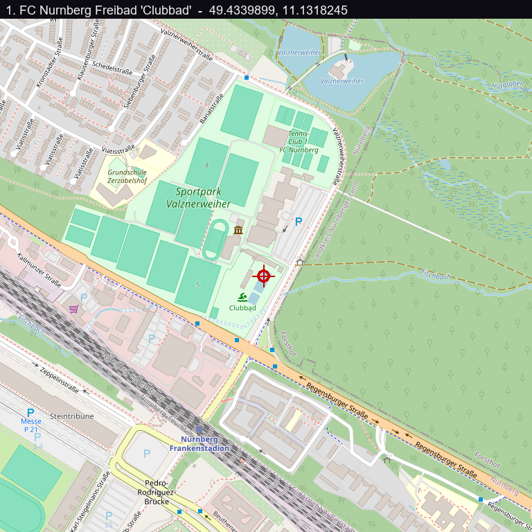

Flag: PINK{Söd3r_Sw33t_C4r0l1ne_0h_0h_0h}
Category: OSINT (reverse image geolocation)
Tools used: browser, Google reverse image search (Lens), Google Maps, curl

Brief: The challenge said "A very prominent Bavarian politician has recently been swimming at the start of August and was not afraid to publish his experience! Find the exact location he was swimming in." The target is https://osint.pink.bayern/2/, a "select the location on a map" geolocation challenge.

Steps:
1. Start point: identify the page
   - What I found: a Leaflet map with a "Select a location" and "Submit location" flow. Clicking a point POSTs lat and lon to ?check=1, and the server replies {"ok":true,"message":"PINK{...}"} only for the right spot.
   - What I found: the server gives no distance hint (just "Try harder!") and rate-limits, so guessing is out.
   - Dead end: the embedded pannellum panorama pano.jpg is a decoy. It renders the CTF logo, and the 1.6 MB appended to it is high-entropy filler with no key.
   - Thinking: when the server check is the win condition, the coordinates have to come from real-world research, not from the handout's noise.

2. Pivot: identify the politician and the post
   - What I did: matched "Bavarian politician who posts himself eating, dancing, playing football, swimming" to Markus Söder (CSU), famous for exactly these Instagram posts.
   - Result: his early-August swim post is a selfie in an outdoor pool with the caption "Urlaubszeit in Bayern: Sommer, Sonne, Schwimmen. Macht den Kopf frei, erfrischt und hält fit."
   - Thinking: the caption and the August date matched the challenge text, so this was the photo to geolocate.

3. Pivot: geolocate the pool
   - What I found: the photo shows an outdoor lane pool with red and white lane ropes, a tall conifer forest right behind it, and sun umbrellas.
   - What I did: ran a reverse image search (Google Lens) on the selfie. It returned an exact match from the Instagram account @1.fcn_clubbad, the "Clubbad", the swimming pool of 1. FC Nürnberg (Söder is a well-known FCN fan).
   - What I did: looked it up in Google Maps: "1. FCN Freibad Clubbad", Valznerweiherstraße 200, 90480 Nürnberg-Ost. The Maps photos match the selfie (same pool, lane ropes, forest backdrop).
   - Result: coordinates 49.4339899, 11.1318245.

     

4. Pivot: submit
   - What I did: POSTed lat=49.4339899 and lon=11.1318245 to ?check=1.
   - Result: the server answered {"ok":true, "message":"PINK{Söd3r_Sw33t_C4r0l1ne_0h_0h_0h}"}.

Key insight: Geolocation OSINT is chaining small clues. The caption plus one reverse image search gave the exact venue in a single hop, because the pool's own Instagram had reposted the photo. The flag even nods to it: "Sweet Caroline" is 1. FC Nürnberg's stadium anthem. Ignore the decoy panorama and spend the effort on the real-world location.

Reproduce: run curl -s 'https://osint.pink.bayern/2/?check=1' --data 'lat=49.4339899&lon=11.1318245'

Note: there is no reproduction capture, because the challenge input files are not in this repo.
