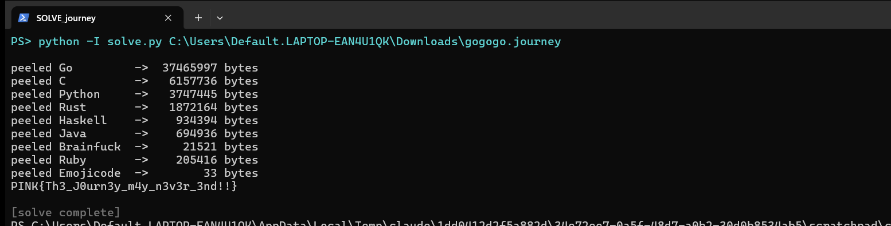

Flag: PINK{Th3_J0urn3y_m4y_n3v3r_3nd!!}
Category: Reverse Engineering (nine-language decoder chain)
Tools used: Python (NumPy, pycryptodome), reading source in 9 languages

Brief: The challenge said "Go on a journey through time and languages with me! Perhaps you will learn something new!" It gave one file, gogogo.journey (71.5 MB, not committed here because of its size). It is worth 75 points, by author QWERTZ.

Steps:
1. Start point: the approach for every layer
   - What I found: every layer is a program in a different language. Each one decodes an embedded blob into the next program and prints a hint that names the next language.
   - What I found: every layer hides its strings (output filename, hint) by XOR with 0xAA, and most use a 4-byte big-endian length prefix.
   - Dead end: every layer also has decoy code, such as opq(), z9(), phantom_branch(), crema() or r9(). These are xorshift tests of the form (x & 0xF) == 0x11 or (t & 15) == 17, which can never be true, so the "decoy.bin" and "ghost.bin" writes never happen.
   - Thinking: I never ran the challenge's code. For each layer I read the decoder, ignored the dead branches, and reimplemented the real transform in Python. That way every step is understood, not just executed, and nothing untrusted ever runs.

2. Layer 1: Go, 71.5 MB to 37.5 MB
   - What I found: the hint reads "This Google language is a bit unusual..."
   - What I did: pt[i] = ror1(((ct[i] - (i^2 + 31i + 107)) * 13) mod 256), vectorised in NumPy.
   - Thinking: a Python loop over 37M bytes is far too slow, so NumPy was the way to do it.

3. Layer 2: C, the standard
   - What I found: 37.5 MB shrinks to 6.2 MB, and the file holds 72 encrypted source lines.
   - What I did: line_de() uses a per-line xorshift32 keystream, seeded from 0xC0FFEE00, the line index, the length and the salt. The bytes are subtracted by the salt, rotated right by 3, XORed with the keystream, and then j + line is subtracted.

4. Layer 3: Python, fight snakes
   - What I found: 6.2 MB shrinks to 3.7 MB.
   - What I did: 10 rounds of zlib.decompress, each followed by XOR with sha256(s + [round] + s).

5. Layer 4: Rust, rusted
   - What I found: 3.7 MB shrinks to 1.9 MB.
   - What I did: ror1(b ^ (131*i & 0xFF) ^ "1337coffee"[i % 10]).

6. Layer 5: Haskell, a classic again
   - What I found: 1.9 MB shrinks to 0.9 MB. Most functions are identity padding (reverse . reverse, splitAt then append, xor 0).
   - Result: the only real step is d4: byte[i] - (i+1) mod 256.

7. Layer 6: Java, coffee
   - What I found: 0.9 MB shrinks to 0.7 MB. This is the only layer with real cryptography, AES-256-GCM. The key is PBKDF2-HMAC-SHA256 with password "espresso-beans-42" (the two XOR loops cancel out), a base64 salt, 7000 + 2^11 + 17*29 = 9,541 iterations, and a 256-bit length. The AAD is the output filename.
   - What I found: the ciphertext is built by reflection. Every String field named cappuccino_NNN is joined in name order.
   - Result: the GCM tag verified, which proves the key and every parameter are exactly right.

8. Layer 7: Brainfuck, my brain is completely scrambled
   - What I found: 695 KB of + - . characters, with no loops and no input.
   - What I did: a tiny interpreter just collects the output.
   - Result: 21 KB, a line about rubies, then base64.

9. Layer 8: Ruby, mine rubies
   - What I found: a "JRNYv2" header gives 6 rounds, a 24-byte key length, a salt, a gzip flag and the final size.
   - What I did: each round XORs with sha256(salt + round)[:24], the last round first, and the result is gunzipped.
   - Result: 205 KB, and the output size matches the header.

10. Layer 9: Emojicode, hungry for some grapes
   - What I found: eight fruit constants, then 33 blocks of "if 1 == 1", each computing a constant XOR all the fruit constants, where the left-arrow cross emoji is ^=. The value is then looked up in that block's own if-chain, which prints one character.
   - Thinking: I parsed each block's table instead of assuming plain ASCII, because the lookup tables are per block.
   - Result: the 33 characters give the flag. My solve.py run peeled all nine layers and ended with it.

     

Key insight: Layered obfuscation only costs time, not security. Each layer is a fixed, keyless transform, or a key stored right next to the data, as in the Java AES layer. The skill this trains is reverse engineering: reading unfamiliar languages, separating the live code path from decoys, and reimplementing a decoder safely instead of running untrusted code. That is the same habit as triaging a malware dropper chain.

Reproduce: run python solve.py gogogo.journey (about 30 s). It prints each layer's size and asserts the flag.

Note: the screenshot is a live re-run on the handout, and the flag matches the recorded one.
