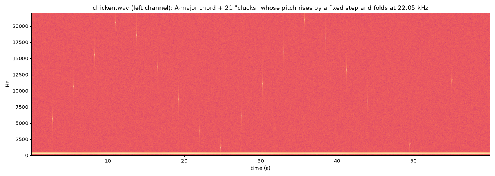
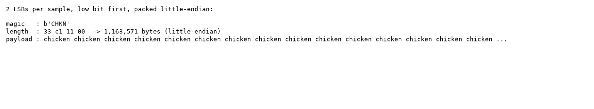

Flag: PINK{Cluck_Cluck_you_are_a_duck!}
Category: Steganography (WAV LSB and Chicken esolang)
Tools used: Python (wave, numpy, matplotlib), a small Chicken esolang interpreter (solve.py)

Steps:
1. Start point: chicken.wav (10.5 MB, 60 s)
   - What I found: a plain RIFF/WAVE file, 16-bit PCM, stereo, 44.1 kHz. The data chunk fills the whole file, so nothing is appended after the audio and there are no extra metadata chunks.
   - Thinking: no container tricks means the data is hidden inside the samples themselves.

2. Dead end: the spectrogram
   - What I found: a steady A-major chord (220 / 277 / 330 / 440 Hz) with a slow tremolo, plus 21 short "clucks" (a decaying tone, one every ~2.75 s) at pitches that jump around between 1 kHz and 21 kHz.
   - Dead end: the cluck pitches looked like they could spell something, but they rise by a constant ~4,950 Hz each time and fold back at the Nyquist limit (22,050 Hz). They follow a formula, so they carry no data. The tones' amplitude and frequency also demodulate to smooth curves with no data, and the left/right difference is just a slow pan.
   - Thinking: the audible layer is a decoy.

     

3. Pivot: the low bit planes
   - What I did: split every sample into bit planes and checked each plane for repetition over time.
   - Result: bits 0 and 1 repeat on a short cycle for the first 52.77 s, then turn random. Bits 2 and up are random throughout.
   - Thinking: real recorded or synthesized noise never repeats in its lowest bits. A clean edge where the pattern stops is where a written payload ends, and the untouched original noise starts. Two modified bits per sample matches common LSB tools (for example WavSteg's default of 2 LSBs).

4. Pivot: decoding the payload
   - What I did: took the 2 LSBs of every sample (bit 0 then bit 1) and packed them into bytes little-endian. I tried the four combinations of bit order, and only this one gave readable output.
   - Result: magic "CHKN", a 4-byte length (0x0011C133 = 1,163,571 bytes), then "chicken chicken chicken ..." over 2,276 lines.
   - Thinking: "chicken" repeated on separate lines is the Chicken esoteric language: each line is one instruction, and the opcode is the number of times the word "chicken" appears on it. The short repeating LSB cycle was the word "chicken " over and over, and the occasional breaks in it were the newlines.

     

5. Pivot: running the Chicken program
   - What I did: wrote a ~40-line interpreter (opcodes: 0 axe, 1 chicken, 2 add, 3 fox, 4 rooster, 5 compare, 6 pick, 7 peck, 8 fr, 9 BBQ, n>=10 push n-10) and ran it.
   - Result: a "POULTRY COMPUTATION ENGINE v3.1" banner that runs five arithmetic self-tests and ends with "Nothing suspicious detected." No flag.
   - Thinking: the output is another decoy, but the program contains jumps. I logged which instructions actually executed and found eleven blocks that never run.

6. Pivot: the code that never runs
   - What I found: five of the dead blocks are guarded by a conditional jump and just build the string "FAIL" (the self-test failure path). The other six sit behind an always-true jump (push 1, push offset, fr), so they can never execute. Their opcodes look like random junk, but the push literals among them are printable ASCII.
   - Result: block by block, "PINK{Cl" + "uck_Clu" + "ck_you_" + "are_a_d" + "uck!}" gives PINK{Cluck_Cluck_you_are_a_duck!}
   - Dead end: inside dead code, a "pick" does not consume the line after it, so that line has to be read as a literal too. Skipping it dropped the "k" and gave "Cluc_you".
   - Thinking: a program that ends with "nothing suspicious" while carrying unreachable code with printable literals is hiding the real payload in the unreachable part.

Key insight: The flag was in the one place a normal run never reaches, the code the program always jumps over. It sat behind three layers of misdirection: audible clucks that look like a cipher but are a formula, an LSB payload that looks like a meaningless repeating pattern but is source code, and a program whose output says "nothing suspicious".

Reproduce: run python -I solve.py chicken.wav. It extracts the payload, runs the program, and prints the hidden text.
