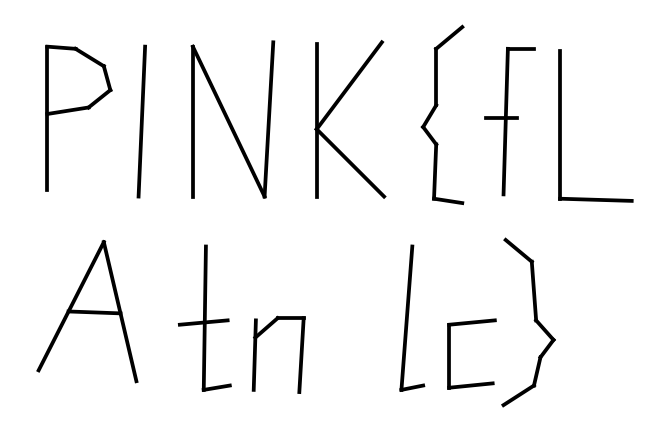

Flag: PINK{fLAg_tnS_calc}
Category: Steganography (TI-Nspire hidden in geometry)
Tools used: file, xxd, Python (struct, re, matplotlib), TnsTools (open-source TNS method-13 decoder), Luna source (reference for the encryption scheme)

Brief: A TI-Nspire document, tns2_pink.tns, with a flag hidden somewhere inside it. The exact scoreboard name and category are unverified, because I had no Pink CTF scoreboard access.

Steps:
1. Start point: identify the container
   - What I did: ran file and xxd on tns2_pink.tns. It starts with *TIMLP0500 followed by what looks like a ZIP local-file header. I parsed the entries by hand: Document.xml and Problem1.xml, both stored with compression method 13 (not a standard ZIP method), and a PK 01 02 central directory at the end.
   - Result: the file is a TI-Nspire document (.tns, OS 3.x+ format). Its XML entries are encrypted and compressed with TI's proprietary method 13.
   - Thinking: method 13 is not deflate, and brute-forcing DES and RC4 guesses against the data failed. A known format needs a known decoder, so I looked for the documented scheme instead of guessing.

2. Pivot: decrypt method 13 and decode the XML
   - What I did: found the scheme in the Luna source: a 40-byte header, then a keystream made by 3DES-encrypting a counter block, XORed over the data, then raw deflate, then a TIXC0100 token stream. Rather than reimplement it, I ran the TnsTools decoder on the file.
   - Result: Document.xml (1166 B) and Problem1.xml (57640 B) decoded with the stored sizes and CRCs both matching. A grep for the flag format immediately found PINK{th1s_15_4_f4k3_fl4g} in Problem1.xml.
   - Dead end: the string literally says it is a fake flag, so I treated it as a decoy and kept looking in the same file.

3. Pivot: inspect the figure's objects
   - What I did: Problem1.xml is a TI GeoGrapher figure. I listed every text, point and segment object with its coordinates.
   - Result: the figure holds 63 points, 45 segments and several text objects: axis labels, the decoy PINK{...} box, and two odd fragments, g_ and S_ca.
   - Thinking: 63 points and 45 segments in a figure with no visible plot looked like letters drawn out of line segments, and the two short text fragments looked like pieces of a string that had to be slotted in somewhere.

4. Pivot: plot the segments and place the text fragments
   - What I did: plotted all segments with matplotlib. My first plot had y inverted, which made the P look like a "b", and plotting y directly fixed it. Then I grouped segments into glyph clusters by x range and compared the gaps with the x positions of the text boxes.
   - Result: the top row reads PINK{fL, and the bottom row reads A, gap, tn, gap, lc}. The gap between A (x 36.3-40.9) and t (42.9) matches the g_ box at x=41.66. The gap between n (ends 48.6) and l (53.1) matches the S_ca box at x=49.5. Reading top row then bottom row gives PINK{fLAg_tnS_calc}.
   - Thinking: the fragments g_ and S_ca landing exactly in the gaps confirms the segments and text are one message split across two kinds of objects.

     

Key insight: The readable flag in the file is a decoy, and the real one is split between line segments drawn as letters and two text fragments that fill the gaps in them. It only appears when the figure is rendered and the gaps are matched to the text positions. If a platform rejects it, the likeliest alternate readings are fl or Fl for fL, and tns or TnS for tnS.

Note: the flag is case-sensitive and read from stick-letter shapes by eye (lowercase t, n, l, c and f, uppercase L and A, uppercase S from the text box), which is the one ambiguity. There is no reproduction capture, because the challenge input files are not in this repo.
