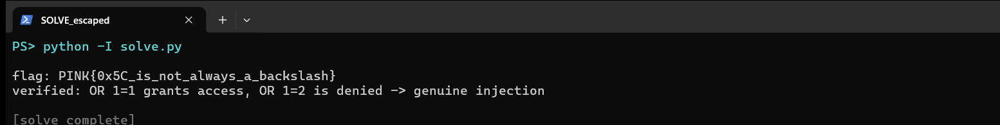

Flag: PINK{0x5C_is_not_always_a_backslash}
Category: Web (multibyte SQL injection)
Tools used: curl, Python (urllib)

Brief: A login portal at https://sqli.pink.bayern/ (POST form, fields username and password) boasts "we escaped all special characters." Quotes and backslashes are indeed escaped the mysqli/addslashes way, but the DB connection uses a multibyte charset. A raw 0xBF byte before my quote absorbs the escaper's 0x5C backslash into one multibyte character, so the quote survives and I break out of the username string. OR 1=1 then logs me in as the target account and the server prints the flag.

Steps:
1. Start point: recon
   - What I found: a single POST form (username and password), no CSRF token, no input reflected back.
   - What I found: every wrong attempt returns the same "Access denied" and the same 3903-byte page. No SQL errors leak.
   - Thinking: with no error output, I needed a side channel to tell a true condition from a false one.

2. Dead end: the easy bypasses
   - What I did: tried raw quotes in username or password, the trailing-backslash two-field trick, array parameters (username[]=...), a JSON body, duplicate parameters, and LIKE wildcards (% and _).
   - Dead end: all of them still gave "Access denied" with no timing change. Raw quotes and the trailing backslash were escaped, so the escaper handles the backslash too, like mysqli_real_escape_string.
   - Thinking: a working backslash escape plus the hint "escaped all special characters" points at the classic multibyte (GBK) bypass.

3. Pivot: find the injection with a time oracle
   - What I found: the escaper turns a quote 0x27 into 0x5C 0x27. But if the DB connection charset is multibyte, the byte pair 0xBF 0x5C is a single character. Putting the raw byte 0xBF right before the quote makes the escaper's 0x5C get absorbed into one multibyte character, and my 0x27 quote stays live and breaks out of the string.
   - What I did: sent username = 0xBF 0x27 followed by " OR SLEEP(3)-- -".
   - Result: the response took about 3 s against a baseline of about 0.8 s. Lead bytes 0xBF, 0xAF, 0x81, 0x95 and 0xDF all worked, while 0xA1 and 0xFF did not (they do not form a valid multibyte pair with 0x5C). The injection works in both the username and password fields.

4. Pivot: log in and read the flag
   - What I did: sent username (raw bytes) = 0xBF 0x27 followed by " OR 1=1-- -", with password = x.
   - What I found: the query becomes WHERE username='<multibyte-char>' OR 1=1-- -' AND password='x', so the condition is always true.
   - Result: the page returns "Access granted: PINK{0x5C_is_not_always_a_backslash}".
   - Thinking: OR 1=2-- - is still denied, which confirms it is the injection logging me in and not a lucky guess.

     

Key insight: Escaping characters is not the same as parameterizing a query, and the flag says it outright: 0x5C is not always a backslash. addslashes and mysqli_real_escape_string prepend 0x5C to a quote, but on a multibyte connection (GBK and similar) a lead byte can consume that 0x5C, so the quote survives.

Defensive takeaways: Use prepared statements with bound parameters, so the data never re-enters the SQL text and byte-boundary tricks cannot help. Set the connection charset to utf8mb4 with mysqli_set_charset so the escaper and the server agree on boundaries. From a GRC angle, "input is escaped" is not a control you can tick. The control is parameterized queries, verified in code review.

Reproduce: run python -I solve.py https://sqli.pink.bayern/ (the --demo flag runs the offline byte-trick self-check). As a one-liner: curl -s https://sqli.pink.bayern/ --data-binary 'username=%BF%27%20OR%201=1--%20-&password=x'

Note: the screenshot is a live re-run against the real server, and a fresh run's flag matches the recorded one.
